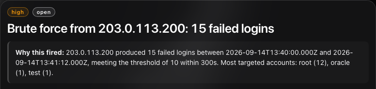

# Watchpost

Watchpost is a local SIEM lab for analysts. Follow failed SSH logins from the raw log to the rule that fired and the accounts it saw.

## Quick start

With Git and Python 3.10+ (SQLite 3.35+), paste this into a macOS or Linux terminal.

```sh
git clone --depth 1 https://github.com/talalkashar/watchpost.git &&
  cd watchpost && ./start.sh --demo
```



The command reads the bundled synthetic SSH log into SQLite in memory. Expect **19 accepted records, one rejected line and two alerts**. One rule counts failures from the address, the other counts failures against the root account. Each run starts fresh and needs no login or running server.

[Try the hosted console](https://watchpost-nxxu.onrender.com) with the read-only user `viewer` and password `watchpost-viewer-demo`. Allow time for the service to wake up.

## Investigate in the browser

1. In the cloned directory, run `./start.sh`. Leave that terminal running and open [the local console](http://127.0.0.1:8080).
2. Sign in as `admin` with the first-start password saved in `data/initial_credentials.txt`. The local console keeps its database between runs.
3. To reproduce the screenshot, open **Ingest**, choose `samples/auth.log`, set **Year (BSD syslog)** to **2026**, tick **Mark as synthetic**, and click **Ingest**. In **Alerts**, open the high-severity SSH alert. Scroll to **Evidence** to read the events behind it.
4. For a fuller dashboard, open **Admin → Load demo data**. On a phone, **Menu** opens the navigation. Stop the local server with Ctrl+C.

## Three investigations to try

| Question | Run from the clone |
| --- | --- |
| Did one address guess several SSH accounts? | `./start.sh --demo ssh` |
| Did a Windows login succeed after repeated failures? | `./start.sh --demo windows` |
| Which denied ports and outbound transfers crossed a firewall rule? | `./start.sh --demo firewall` |

The [example walkthroughs](examples/README.md) pair each result with the source records and a follow-up question. To keep the commands on your PATH, use `pipx install .` from the clone. Run `watchpost-demo windows` or `watchpost-serve`. The packaged console defaults to `~/.local/share/watchpost/data/`. Set `SIEM_DB` to choose the database path.

## Scope and limits

Watchpost normalizes logs, runs explainable rules, and correlates related alerts into incidents. The Python runtime uses the standard library. The console runs in one process and stores its data in SQLite. It is designed for a local lab. Production monitoring at enterprise scale is outside its tested scope.

Bundled logs and demo addresses are synthetic. A detection on these fixtures shows how a rule behaves on that input. Its real-world precision and recall require your own evaluation. Detection runs on ingest or on demand. The [threat model](docs/THREAT-MODEL.md) describes the security boundaries.

## Reference

- [Detection rules and thresholds](docs/REFERENCE.md#detection-rules) · [API](docs/API.md) · [Live ingest](docs/LIVE_INGEST.md) · [Deployment](deploy/README.md)
- [Dashboard with ATT&CK legend: validated, mapped, disabled, and gap](docs/screenshots/01-dashboard-1117.jpg) · [Incident board](docs/screenshots/02-incidents-1117.jpg) · [Alert queue](docs/screenshots/03-alerts-1117.jpg) · [Investigation graph](docs/screenshots/07-investigation-graph.jpg)
- [Changelog](CHANGELOG.md) · [Contributing and running tests](CONTRIBUTING.md) · [Report a security issue](SECURITY.md) · [MIT license](LICENSE)

[](https://github.com/talalkashar/watchpost/actions/workflows/tests.yml)

## Credits

Built by [Talal Kashar](https://github.com/talalkashar). Juan Carlos Munera ([LinkedIn](https://www.linkedin.com/in/juanmunera), [GitHub](https://github.com/juancarlosmunera)) contributed the asset inventory (#9), the CloudTrail collector (#80), Windows Event Forwarding collection and its forwarder (#81, #87), response playbooks (#82), tiered retention (#83), multi-stage correlation rules (#84) and threat intelligence feeds (#85), and suggested several hardening changes after reviewing the project.
