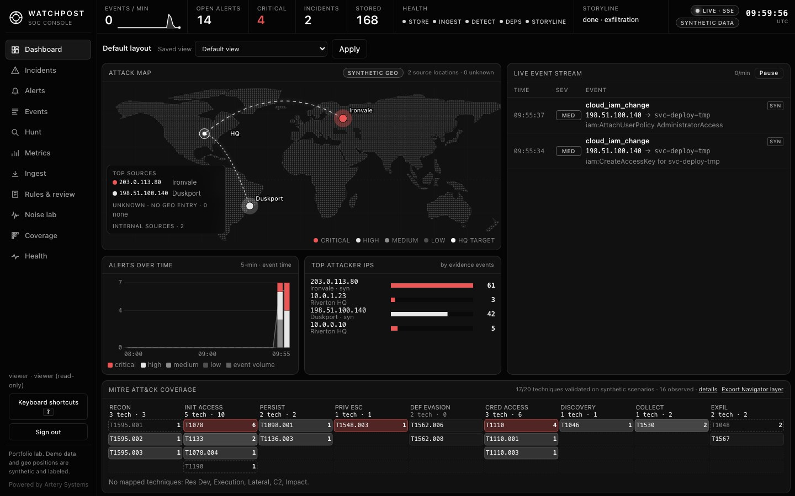
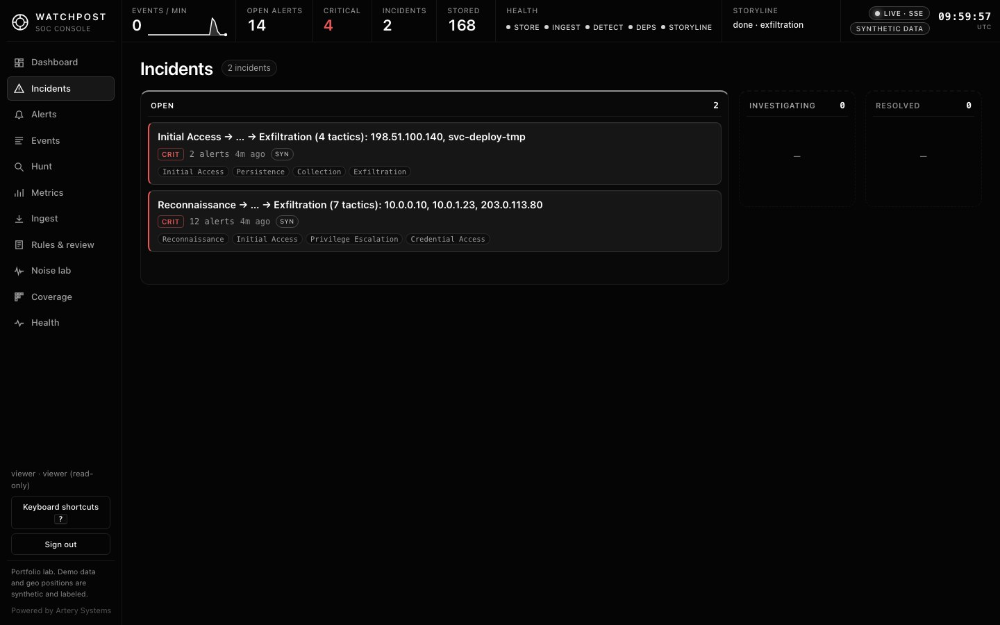
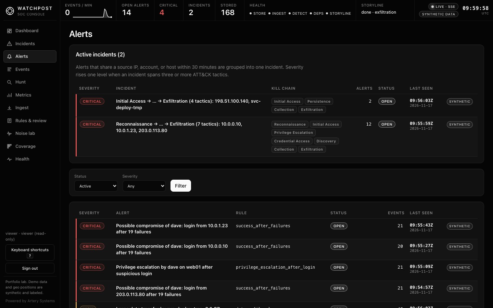

# Watchpost

Watchpost is a SIEM in the Python standard library. It ingests logs, runs explainable detection rules, correlates alerts into incidents, and tracks each case from triage to resolution. It has no third-party dependencies.

[](https://github.com/talalkashar/watchpost/actions/workflows/tests.yml)


[](LICENSE)
[](https://scorecard.dev/viewer/?uri=github.com/talalkashar/watchpost)

**[Live demo](https://watchpost-nxxu.onrender.com)** · read-only login `viewer` / `watchpost-viewer-demo` (free tier: the first load can take a minute) · [Full reference](docs/REFERENCE.md)



| Incident board | Alerts and correlated incidents |
|---|---|
|  |  |

## What it does

- **Ingests** JSON, CSV, Linux `auth.log`, Windows Security events, nginx and Apache access logs, firewall and VPN logs, and cloud audit logs. Input is a file upload, an authenticated API, a syslog listener, `scripts/shipper.py`, the read-only CloudTrail collector, or the experimental Windows Event Forwarding collector. Normalization writes one schema.
- **Detects** with fifteen built-in rules. Each rule is a pure function. Each alert stores a plain-English explanation and the event ids behind it. The rules are listed under [Detections](#detections).
- **Maps to MITRE ATT&CK.** Today's catalog is the 20 techniques in `watchpost/attack.py`, not the full matrix. A technique is validated only when an enabled rule detects a labeled synthetic scenario tagged with that technique. That grade is not a claim about real traffic. The other grades are mapped, disabled, and gap.
- **Correlates** alerts that share an IP, account, or host into incidents with kill-chain stages. An incident exports a case record as JSON or Markdown, and a report as Markdown or PDF.
- **Graphs the evidence.** Open **Graph** to follow a detection to its hosts, accounts, source IPs, and incident. Gold arcs connect alerts in the same incident that share evidence entities within 30 minutes. [See the investigation graph](docs/screenshots/07-investigation-graph.jpg).
- **Hunts** with one line: `field:value`, `NOT`, `last:7d`, and one of `| stats`, `| top`, or `| timechart`. The compiler uses a field whitelist and bound values. A saved search can be promoted to a detection.
- **Responds** with a playbook for every alert: automatic context, steps an analyst checks off, and response actions (block an address, disable an account, isolate a host) that are sent as signed requests to a webhook you configure. Watchpost never carries out an action itself.
- **Tunes** from analyst feedback. The proposal is backtested on stored events. A second person approves it. Rules export and import as versioned JSON. A subset of Sigma imports.
- **Secures itself** with PBKDF2 password hashes, lockout, server-side sessions, TOTP, and CSRF protection. The audit log is a hash chain. `viewer_masking` defaults to off (`0` in `watchpost/improve.py`). When a reviewed change sets it to `1`, only the `viewer` role sees pseudonyms (`user-` and `internal-`, eight hex digits) for known usernames and internal IPs. Analyst and admin responses are not masked. Public IPs, host names, and the signed-in viewer's own name stay visible.

## Detections

Fifteen threshold rules. No machine learning. Default parameters are in `watchpost/rules.py`. Asset criticality can raise an alert after the rule fires. Imported Sigma rules and promoted saved searches run on the same engine. They are not in this list.

| Rule | What it catches | Severity | ATT&CK |
|---|---|---|---|
| `brute_force_ip` | Many failed logins from one source IP | high | T1110.001 |
| `password_spray` | One source IP failing across many accounts | high | T1110.003 |
| `account_repeated_failures` | Many failures against one account, from any IPs | medium | T1110 |
| `success_after_failures` | A successful login after repeated failures | critical | T1110, T1078 |
| `off_hours_privileged_login` | A privileged login outside business hours (UTC) | medium | T1078.003 |
| `web_scanner` | Scanner-like web probes from one source IP | medium | T1595.002, T1595.003, T1190 |
| `firewall_port_sweep` | The firewall denies one source IP on many ports | medium | T1046, T1595.001 |
| `impossible_geo_login` | The same account in two places, faster than travel allows | high | T1078, T1133 |
| `privilege_escalation_after_login` | sudo, su, or runas soon after a login that followed failures | critical | T1548.003, T1078 |
| `cloud_iam_change_by_new_principal` | An IAM change by a principal with no recent cloud activity | high | T1098.001, T1136.003, T1078.004 |
| `data_exfil_volume` | A large outbound transfer, or many cloud data reads, by one principal | high | T1530, T1048 |
| `unsanctioned_cloud_service` | Use of a cloud service that is not on the sanctioned list | medium | T1567 |
| `cloud_logging_disabled` | A cloud audit request whose action is `StopLogging`, `DeleteTrail`, or `DeleteFlowLogs`, including a denied call | high | T1685.002 |
| `admin_action_from_new_source` | A privileged action from a source IP new to that principal | medium | T1078, T1078.004 |
| `log_source_silent` | A source with a learned cadence goes quiet (an arrival gap, not a fixed event count) | medium | T1685 |

Impossible-travel positions come from a synthetic geo table for demo address ranges only (RFC 5737 and RFC 1918). That is not a GeoIP lookup. An unmapped address does not alert. `data_exfil_volume` stays on flat thresholds unless an approved exception turns on a per-principal baseline. `log_source_silent` compares arrival gaps with a learned cadence. A gap is not proof the source was tampered with. `cloud_logging_disabled` matches the action name on the request, including a denied call, and does not prove that logging stopped.

Open **Alerts** (`#alerts`), then a row (`#alerts/<id>`). The **Evidence** card lists the stored events for that alert. The same rows are the `evidence` array on `GET /api/alerts/<id>`.

## How it works

One process. SQLite stores the events. Detection runs on ingest and when an analyst runs it.

```
 log files ──► POST /api/ingest/upload ─┐
 shipper.py ─► (same, ingest token) ────┤
 collectors ─► POST /api/ingest (token) ├─► normalize.py ──► events (SQLite) ──► engine.run_detection
 simulator ──► (same API, loopback) ────┤   parse + validate      │                 │  rules.py (pure functions)
 syslog ─────► syslog_listener.py ──────┘   + redact secrets      │                 ▼
                                                                  │            alerts + alert_events
                                                                  ▼                 │
 browser UI (static/) ◄── server.py (auth, CSRF, roles) ◄── queries.py ◄────────────┘
                                   │
                                   ├── health.py   storage / ingestion / detection / dependencies
                                   └── improve.py  feedback → performance → suggestions → reviewed changes
                                                   + evaluation against labeled synthetic scenarios
```

## Quick start

```bash
git clone https://github.com/talalkashar/watchpost.git
cd watchpost
./start.sh        # http://127.0.0.1:8080
```

On first start, generated passwords are written to `data/initial_credentials.txt` (mode 0600). Set `SIEM_ADMIN_PASSWORD`, `SIEM_ANALYST_PASSWORD`, and `SIEM_VIEWER_PASSWORD` to choose them. Sign in as `admin`. Open **Admin → Load synthetic demo data**.

```bash
./run_tests.sh    # unit and integration tests, then a 26-step end-to-end smoke check
```

CI runs the suite on Python 3.11 through 3.14.

## Documentation

| | |
|---|---|
| [Reference](docs/REFERENCE.md) | Every feature, the architecture, configuration, performance numbers and limits |
| [API](docs/API.md) | HTTP API reference |
| [Live ingestion](docs/LIVE_INGEST.md) | Syslog listener (plaintext and TLS), rsyslog forwarding, the file shipper, the CloudTrail collector, and experimental Windows Event Forwarding |
| [Threat model](docs/THREAT-MODEL.md) | What it protects, what it assumes, and what it does not cover |
| [Deployment](deploy/README.md) | Debian 12 kit: hardened systemd service behind Caddy or nginx |
| [Changelog](CHANGELOG.md) | What changed in each release |

## Scope, honestly

Watchpost is a portfolio and learning project, not a production SIEM. All bundled data is synthetic. It runs as a single process on SQLite, was measured up to 250,000 events on one laptop, and runs detection on ingest and on demand rather than on a schedule. The [reference](docs/REFERENCE.md#what-is-real-vs-synthetic-vs-future) lists what is real, what is synthetic and what is not built.

## Credits

Built by [Talal Kashar](https://github.com/talalkashar). Juan Carlos Munera ([LinkedIn](https://www.linkedin.com/in/juanmunera), [GitHub](https://github.com/juancarlosmunera)) contributed the asset inventory (PR #9) and suggested several hardening changes after reviewing the project.

## License

[MIT](LICENSE). Security issues: see [SECURITY.md](SECURITY.md).
