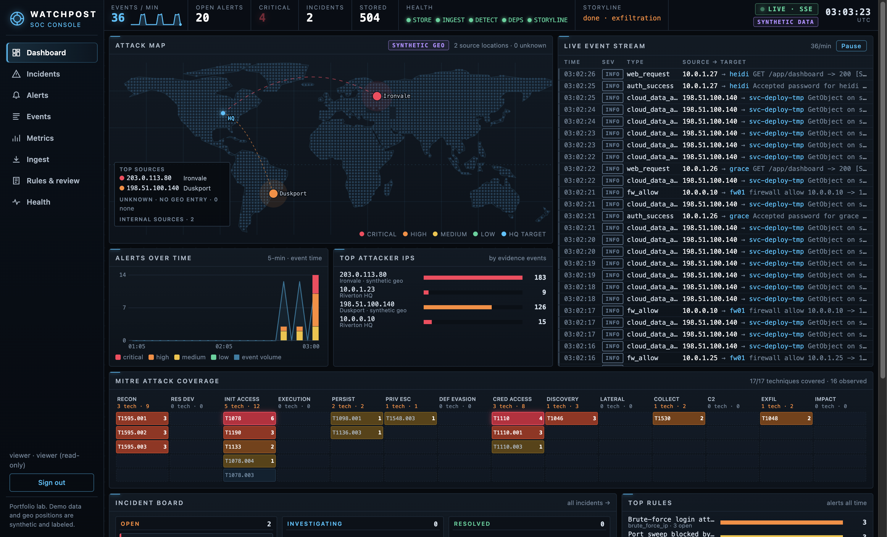
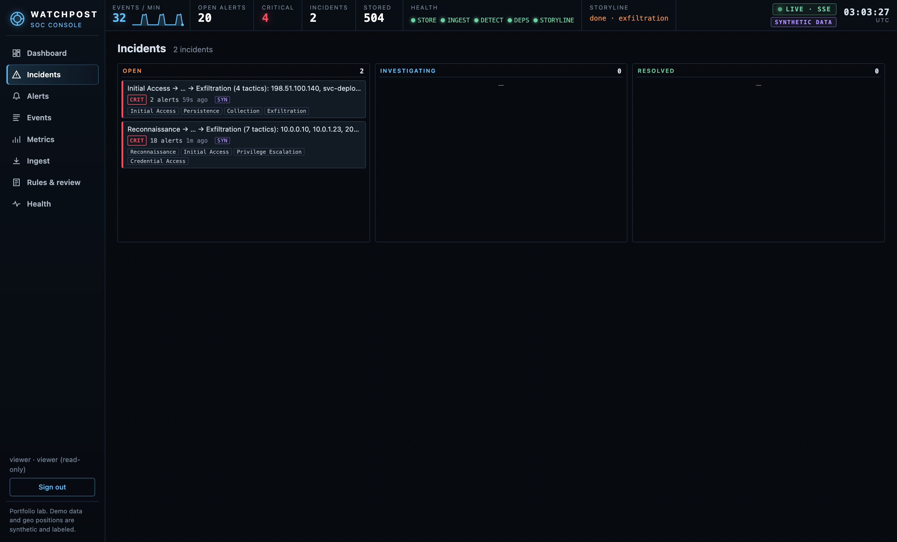
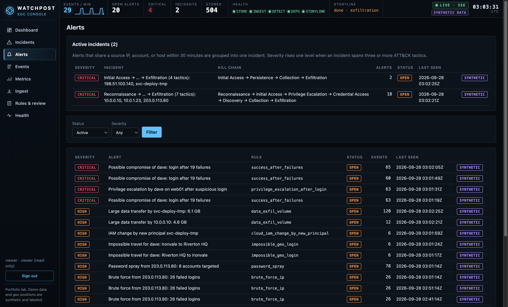

# Watchpost

**A small, working SIEM in pure Python.** Ingest logs, detect attacks with explainable rules, correlate alerts into incidents, and work them from triage to resolution, with nothing to install beyond Python.

[](https://github.com/talalkashar/watchpost/actions/workflows/tests.yml)


[](LICENSE)
[](https://scorecard.dev/viewer/?uri=github.com/talalkashar/watchpost)

**[Live demo](https://watchpost-nxxu.onrender.com)** · read-only login `viewer` / `watchpost-viewer-demo` (free tier: the first load can take a minute) · [Full reference](docs/REFERENCE.md)



| Incident board | Alerts and correlated incidents |
|---|---|
|  |  |

## What it does

- **Ingests** JSON, CSV, Linux `auth.log`, Windows Security events, nginx/Apache, firewall/VPN, and cloud audit logs, through file upload, an authenticated API, a syslog listener (plain or TLS) or a file shipper. Everything is normalized into one schema.
- **Detects** with fifteen built-in rules written as pure functions, each with a plain-English explanation and the evidence behind every alert.
- **Maps to MITRE ATT&CK** and grades coverage by evidence: a technique is only "validated" when an enabled rule catches a labeled attack scenario.
- **Correlates** alerts that share an IP, account or host into incidents with kill-chain stages, then exports case records and PDF reports.
- **Hunts** with a one-line query language (`field:value`, `NOT`, `last:7d`, plus `| stats`, `| top`, `| timechart`) compiled from a field whitelist with bound values, and turns saved searches into detections.
- **Tunes safely.** Rule changes come from analyst feedback, are backtested against stored events first, and need approval from a second person. Rules export and import as versioned JSON, and a Sigma subset imports.
- **Secures itself:** PBKDF2 passwords, lockout, server-side sessions, TOTP two-factor, CSRF protection, a tamper-evident audit log (hash chain), and data masking for viewers.

## How it works

```
 log files ──► POST /api/ingest/upload ─┐
 shipper.py ─► (same, ingest token) ────┤
 collectors ─► POST /api/ingest (token) ├─► normalize.py ──► events (SQLite) ──► engine.run_detection
 simulator ──► (same API, loopback) ────┤   parse + validate      │                 │  rules.py (pure functions)
 syslog ─────► syslog_listener.py ──────┘   + redact secrets      │                 ▼
                                                                  │            alerts + alert_events
                                                                  ▼                 │
 browser UI (static/) ◄── server.py (auth, CSRF, roles) ◄── queries.py ◄────────────┘
                                   │
                                   ├── health.py   storage / ingestion / detection / dependencies
                                   └── improve.py  feedback → performance → suggestions → reviewed changes
                                                   + evaluation against labeled synthetic scenarios
```

## Quick start

```bash
git clone https://github.com/talalkashar/watchpost.git
cd watchpost
./start.sh        # http://127.0.0.1:8080
```

Passwords are generated on first start and written to `data/initial_credentials.txt` (mode 0600); set `SIEM_ADMIN_PASSWORD`, `SIEM_ANALYST_PASSWORD` and `SIEM_VIEWER_PASSWORD` to choose your own. Sign in as `admin`, then open **Admin → Load synthetic demo data**.

```bash
./run_tests.sh    # 618 unit and integration tests + a 26-step end-to-end smoke check
```

CI runs the suite on Python 3.11 through 3.14.

## Documentation

| | |
|---|---|
| [Reference](docs/REFERENCE.md) | Every feature, the architecture, configuration, performance numbers and limits |
| [API](docs/API.md) | HTTP API reference |
| [Live ingestion](docs/LIVE_INGEST.md) | Syslog listener (plain and TLS), rsyslog forwarding, the file shipper |
| [Threat model](docs/THREAT-MODEL.md) | What it protects, what it assumes, and what it does not cover |
| [Deployment](deploy/README.md) | Debian 12 kit: hardened systemd service behind Caddy or nginx |
| [Changelog](CHANGELOG.md) | What changed in each release |

## Scope, honestly

Watchpost is a portfolio and learning project, not a production SIEM. All bundled data is synthetic. It runs as a single process on SQLite, was measured up to 250,000 events on one laptop, and runs detection on ingest and on demand rather than on a schedule. The [reference](docs/REFERENCE.md#what-is-real-vs-synthetic-vs-future) lists what is real, what is synthetic and what is not built.

## Credits

Built by [Talal Kashar](https://github.com/talalkashar). Juan Carlos Munera ([LinkedIn](https://www.linkedin.com/in/juanmunera), [GitHub](https://github.com/juancarlosmunera)) contributed the asset inventory (PR #9) and suggested several hardening changes after reviewing the project.

## License

[MIT](LICENSE). Security issues: see [SECURITY.md](SECURITY.md).
