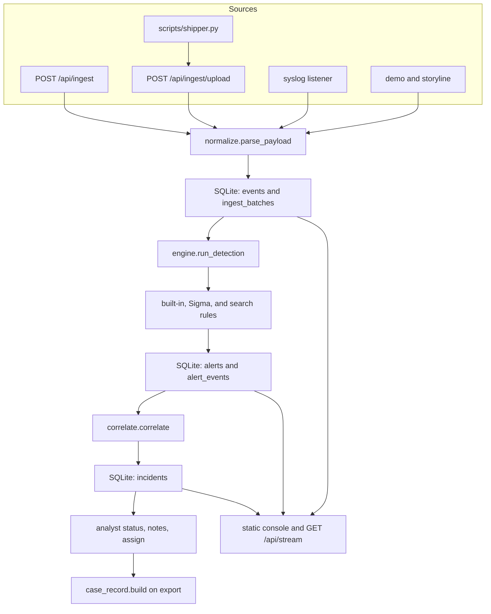

# Architecture

Watchpost is one Python process. It has no third-party libraries. `main.py` starts `watchpost.server` on the standard-library `ThreadingHTTPServer`. The browser console is the files in `static/`. The same process can also start a syslog listener and a demo storyline timer.

The database is one SQLite file. The default path is `data/watchpost.db` (`SIEM_DB`). File databases use WAL. Schema version is 15. Each HTTP request opens its own connection and closes it when the response is done.

## Components

| Piece | Module | Job |
|---|---|---|
| HTTP API and static files | `server.py` | Routes, cookies, CSRF, roles, rate limits, downloads |
| Config | `config.py` | Environment variables only. No hard-coded secrets |
| Parse | `normalize.py` | Turn a payload into events or rejections |
| Ingest and detection | `engine.py` | Store a batch, run rules, open or extend alerts, correlate |
| Rules | `rules.py` | Fifteen built-in pure functions. Each returns findings |
| Extra rules | `sigma.py`, `search_rules.py` | Imported Sigma rules and promoted hunts. Same finding shape |
| Grouping | `grouping.py` | Optional reviewed fields that replace an alert's dedup key |
| Correlation | `correlate.py` | Pure grouping of alerts into incidents |
| Incidents | `incidents.py` | Read incidents, change status, ATT&CK coverage |
| Case and report | `case_record.py`, `report.py` | Assemble an export. Nothing is stored as a case row |
| Assets | `assets.py` | Inventory match can raise an alert's severity |
| Sources | `sources.py` | Arrival cadence and the `log_source_silent` rule |
| Hunt | `hunt.py` | Whitelisted query language over stored events |
| Change control | `improve.py`, `backtest.py` | Suggestions, backtests, second-person approval |
| Auth | `auth.py`, `totp.py` | Users, sessions, TOTP, API tokens |
| Masking | `masking.py` | Pseudonyms on viewer responses when the setting is on |
| Audit | `db.py` | Hash-chained `audit_log` |
| Live UI | `stream.py` | In-process broker. `GET /api/stream` is server-sent events |
| Health | `health.py` | Storage, ingestion, detection, dependencies. Syslog and storyline register while they run |
| Syslog | `syslog_listener.py` | Optional UDP and TCP intake |
| Shipper | `scripts/shipper.py` | Separate process. Tails files and posts them to the upload API |
| Demo | `simulate.py`, `storyline.py` | Labeled synthetic events through the same ingest path |

## Data flow

Every record parse accepts becomes one row in `events`. A record parse refuses is a rejection with a reason. Parse does not drop a record silently. A full syslog queue drops frames without writing a rejection; that limit is under Ingest. Stored text is length-capped. Secret-looking strings are redacted before they are saved.

### Ingest

Five paths call the same store:

1. `POST /api/ingest` takes JSON. The body is one event, an array, or `{"source", "synthetic", "events"}`.
2. `POST /api/ingest/upload` takes a UTF-8 file. Query keys are `format`, `source`, `synthetic`, and `year`. `format=auto` is the default.
3. `scripts/shipper.py` tails files and posts complete lines to the upload route with a bearer token.
4. When `SIEM_SYSLOG=1`, the listener queues RFC 3164 and RFC 5424 frames and flushes them through `engine.ingest` about every two seconds. The submitted source is `syslog`. Syslog has no authentication. It binds to `127.0.0.1:5514` unless configured otherwise. The queue holds 50,000 frames. Past that, a frame is counted as dropped and is not stored. Live file and syslog setup is in [LIVE_INGEST.md](LIVE_INGEST.md).
5. Demo load, one-scenario simulate, and the storyline call `engine.ingest` in process and mark the rows synthetic. Synthetic sources are prefixed with `demo:`.

`normalize.parse_payload` accepts `json`, `jsonl`, `csv`, `authlog`, and `weblog`. It also maps common field names, Windows Security event IDs, and CloudTrail-shaped records onto one event type set. A batch stops at `SIEM_MAX_BATCH_EVENTS` (default 20,000). An upload stops at `SIEM_MAX_UPLOAD_BYTES` (default 5 MiB).

`engine.store_batch` writes the events and one `ingest_batches` row in one transaction. The batch id is a UUID. Detection status starts as `pending`. If the write fails, the batch is not stored.

### Detection

If the batch has accepted events, `engine.ingest` runs detection on that call. The scan covers the batch's timestamps, widened by the longest enabled rule window. Rules that need earlier context also read a history span, and only the event types they use. A full scan is `POST /api/detection/run`. That route has no time window, so it reads every stored event.

One process-wide lock serializes detection runs. Two ingests cannot create the same alert twice.

Each enabled rule is a pure function of `(events, params)`. Built-in ids live in `rules.RULE_FUNCTIONS`. A rule id that starts with the Sigma or search prefix uses that module's `run` instead. `log_source_silent` does not use the scanned events. It reads recent arrivals against the wall clock.

A finding is a group key, evidence event ids, a time span, a title, and an explanation. Reviewed grouping fields can replace the key. Active suppressions drop a `(rule_id, group_key)` pair. A rule-wide suppression window drops every finding from that rule. `data_exfil_volume` is the exception: an approved suppression turns on that principal's baseline instead of skipping the finding.

`_apply_finding` opens an alert or extends one. It extends the newest unresolved alert with the same rule and group key when the gap between that alert's span and the finding is at most the rule's `window_seconds`. A gap of exactly that window still extends the alert. A larger gap opens a new alert. A later open alert does not absorb an earlier burst that sits farther away than the window. If every evidence id in the finding is already attached to an alert of that rule and group key, including a resolved alert, the finding is left unchanged. A new alert can still link an event id that already sits on a resolved alert when the finding also has new ids. The same event is not attached twice on one alert. New alerts start as `open`. A resolved alert is not reopened. An extended alert stays synthetic only when that alert and the new finding are both synthetic. Real evidence clears the flag. The rule's severity is the base. `assets.weigh` may raise it when evidence touches a known host or address, especially a high-criticality asset or one tagged with sensitive data. The note that explains the change is stored on the alert.

A failed run is written to `detection_runs` and `error_log`. The events stay. The batch's `detection_status` becomes the run status. A later full scan marks earlier failed batches `recovered`.

### Correlation

After alerts are stored, `correlate_alerts` groups them. Two alerts are related when evidence events share a source IP, account, or host within 30 minutes. The clock is the evidence timestamp, not the alert's whole span. Relations chain. An alert belongs to one incident. Two existing incidents are never merged. A new alert that touches two open incidents joins the older one.

A new incident opens when the group has two or more alerts, or one critical alert. Severity is the highest alert severity. It goes up one level when the alerts span three or more ATT&CK tactics. Reruns are safe. Correlation failure does not roll back the alerts. The detection run records `correlation: failed`, and a later detection run tries again.

### Alert and incident work

Analysts move an alert through `open`, `investigating`, and `resolved`. Resolving requires a disposition: `true_positive`, `false_positive`, or `benign`. Reopening clears the disposition. The first leave from `open` sets `acknowledged_at`. Moving to `investigating` sets the assignee to the actor. `POST /api/alerts/{id}/assign` can hand the alert to an enabled analyst or admin without changing status. Notes go to `alert_notes`. Status, assignment, evidence, and severity changes go to `alert_activity`.

Incidents use the same three statuses. Moving an incident to `investigating` sets its assignee to that actor. There is no separate incident-assign route. Status changes are audited.

### Case

A case is built when someone asks for it. `GET /api/incidents/{id}/case.json` and `case.md` call `case_record.build`. The record joins the incident, every linked alert, and the incident's evidence page. That page is already capped. `events_omitted` is copied, and the case does not cap evidence again. Notes, activity other than `note_added`, and `incident_status_changed` audit rows are the newest 100 of each. The timeline is ordered by time, then by type. Counts past those caps are `events_omitted`, `notes_omitted`, `activity_omitted`, and `status_changes_omitted`. The export is audited as `case_exported`. The route contract is in [API.md](API.md).

`GET /api/alerts/{id}/report.md|pdf` and the same path under incidents build a separate narrative report. PDF bytes are rendered on the way out so a masked viewer is masked before the file is built.

### One batch

`POST /api/ingest` accepts this JSON body. `source` is `bastion01` and `synthetic` is false. Ten events use `type` `login_failed` at `2026-09-15T14:00:00Z`. One uses `type` `login_success` at `2026-09-15T14:00:30Z`. Every event sets `user` to `alice`, `src_ip` to `203.0.113.50`, `host` to `bastion01`, and a `message`: `Failed password for alice` or `Accepted password for alice`. `203.0.113.50` is the documentation address range.

`normalize.parse_payload` accepts all eleven. `login_failed` is stored as `event_type` `auth_failure`, `outcome` `failure`, and severity `low`. `login_success` is stored as `auth_success`, `outcome` `success`, and severity `info`. `source` stays `bastion01`. The timestamps are stored as `2026-09-15T14:00:00.000Z` and `2026-09-15T14:00:30.000Z`. `user`, `src_ip`, `host`, and `message` are unchanged. `GET /api/events/{id}` returns those fields. On an empty database the first failure is event 1 and the success is event 11. Both rows carry that ingest's batch id.

Detection opens three `open` alerts. `GET /api/alerts/{id}` returns:

- `account_repeated_failures`, severity `medium`, group key `alice`, the ten `auth_failure` rows.
- `brute_force_ip`, severity `high`, group key `203.0.113.50`, the same ten rows.
- `success_after_failures`, severity `critical`, group key `alice|203.0.113.50`, those ten rows plus the `auth_success` row.

The failure event lists all three alerts. The success event lists only `success_after_failures`. Evidence on each alert still has `user` `alice`, `src_ip` `203.0.113.50`, and `host` `bastion01`.

The three alerts share that source IP, account, and host inside 30 minutes, so correlation opens one incident. Two tactics do not raise the severity. `GET /api/incidents/{id}` returns status `open`, severity `critical`, title `Initial Access → Credential Access: 203.0.113.50, alice, bastion01`, entities `src_ip` `203.0.113.50`, `user` `alice`, and `host` `bastion01`, and stages Initial Access and Credential Access. The incident events are the same eleven rows. `events_omitted` is 0. The success row's `alert_ids` are only the critical alert.

`GET /api/incidents/{id}/case.json` and `case.md` build that incident. The JSON `format` is `watchpost-incident-case`. The case copies the entities, the three alerts, and `events_omitted` 0. Each timeline `evidence` entry keeps the stored `event_type`, `user`, `src_ip`, `host`, `ts`, `outcome`, and `message`. The markdown file starts `# Incident case #{id}:` and lists the same evidence. Technique rows copy the catalog grade already stored for the enabled rules (`validated`, `mapped`, `disabled`, or `gap`). On a fresh database this case listed `T1078` (Initial Access, the critical alert), `T1110` (Credential Access, the account-failure alert and the critical alert), and `T1110.001` (Credential Access, the brute-force alert), each with `level` `validated`. That grade comes from labeled scenarios for those rules. It is not proof that this batch detected the technique. `mapped` means an enabled rule names the technique and is not proof. This guide adds no coverage claim.

The dashboard, alert list, incident board, and `GET /api/stream` read the same tables. After a batch is stored, the engine publishes the newest events. After a successful detection run, it publishes touched alerts and incidents. The stream is best-effort. A publish error does not fail ingest or detection.

### Rule changes

Seeded rules are inserted on startup. ATT&CK technique lists on built-in rules are refreshed from code. Parameters, enablement, grouping, suppressions, maintenance windows, assets that lower severity, Sigma imports, and hunt promotions go through `change_requests`. The proposer cannot approve their own request. Approval writes `rule_history` and bumps the rule version. Sigma and search rules are added disabled until a labeled sample passes. Confirmed-malicious activity is refused, not suppressed.

## Storage

SQLite tables, grouped by use:

- **Events.** `events` holds the normalized fields plus `synthetic`, `batch_id`, `ingested_at`, and the original `raw`. Indexes cover time, identity fields, source, and batch.
- **Ingest.** `ingest_batches` stores counts, the first 100 rejection reasons, who submitted the batch, and detection status.
- **Detection.** `rules`, `rule_history`, `sigma_rules`, `search_rules`, `detection_runs`.
- **Alerts.** `alerts`, `alert_events`, `alert_notes`, `alert_activity`.
- **Incidents.** `incidents`, `incident_alerts`. One alert maps to one incident.
- **Tuning.** `suppressions`, `rule_suppression_windows`, `maintenance_windows`, `change_requests`, `evaluation_runs`.
- **Inventory and hunt.** `assets`, `saved_searches`, `dashboard_views`.
- **Identity.** `users`, `sessions`, `mfa_pending`, `api_tokens`, `settings`.
- **Operations.** `audit_log`, `error_log`, `health_probe`, `meta`.

`meta.schema_version` is 15. Columns added after 1.0 are applied with `ALTER TABLE` on startup. Foreign keys are on. A writer takes `BEGIN IMMEDIATE`.

The audit log is a hash chain. Each row's hash covers the previous hash and a canonical JSON of id, time, actor, action, target, and detail. With `SIEM_AUDIT_KEY` the hash is HMAC-SHA256. Without a key it is SHA-256, which detects an edit and does not detect a full rewrite of the file. Startup refuses to run if the configured key is not the key that started the chain. Rows written before the chain existed stay unhashed and are reported as legacy.

ECS output (`ecs.py`) is a field mapping for one event on `GET /api/events/{id}/ecs`. Events are not stored as ECS documents.

## Auth

Roles are `viewer`, `analyst`, and `admin`, in that order. A route names the minimum role. `viewer` accounts may only `GET`, plus logout. Ingest routes require `analyst` for a session.

Passwords are PBKDF2-HMAC-SHA256. The default is 310,000 iterations (`SIEM_PBKDF2_ITERATIONS`). A password must be 12 to 256 characters. On first start, unset admin and analyst passwords are random and written once to `data/initial_credentials.txt` with mode `0600`. A `viewer` user is created only when `SIEM_VIEWER_PASSWORD` is set.

A wrong password increments `failed_logins`. The default lock is 5 failures for 15 minutes. Both numbers are settings and can change only through a reviewed request. Unknown and disabled usernames still run a hash compare and return the same 401. A disabled account is not locked by those failures.

Login creates a session. The cookie is `wp_session`. It is `HttpOnly` and `SameSite=Strict`, and `Secure` when `SIEM_SECURE_COOKIES=1`. The database stores the SHA-256 of the token, a CSRF token, an expiry, a public session id, and `last_seen_at`. The default lifetime is 8 hours. State-changing session requests must send that CSRF token in `X-CSRF-Token`. Logout deletes the session row.

If the account has TOTP enrolled, the password step returns a short-lived `mfa_token` instead of a session. `POST /api/auth/mfa` checks the code. A code step can be used once. A wrong code uses the same lockout counter. The TOTP secret is stored on the user row and is not encrypted at rest. Analyst and admin may enroll. A viewer cannot.

API tokens start with `wp_`. Only the hash is stored. A token's role is `viewer` or `analyst`. Capabilities are `read`, `ingest`, and `triage`. A viewer token can only have `read`. Bearer requests skip CSRF. They still need the route's role and the capability for that call. `ingest` covers the two ingest routes. `triage` covers alert notes, alert status, alert assign, and incident status.

`viewer_masking` defaults to off. When it is on, viewer JSON, downloads, and stream frames replace known usernames and internal addresses with HMAC pseudonyms. Analyst and admin responses are not masked. If there are more than 10,000 distinct usernames, the viewer request fails instead of leaking names.

`GET /api/health` is public and returns check names and statuses only. Details require a session. Login and other requests have separate per-IP token buckets. The peer address is used unless `SIEM_TRUST_PROXY=1` and the peer is loopback, in which case the last entry of a single `X-Forwarded-For` header is the client.

The listen address defaults to `127.0.0.1`. `PORT` or `SIEM_PORT` defaults to 8080.

## Request path

Auth sits on every `/api/` route except the public login, MFA, and summary health routes. The static console calls the same API with the session cookie.
